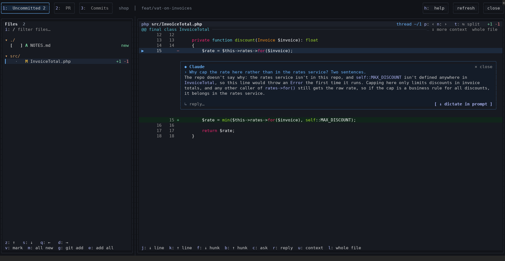
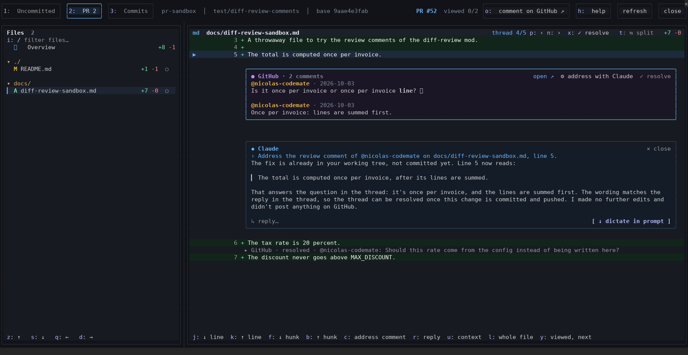
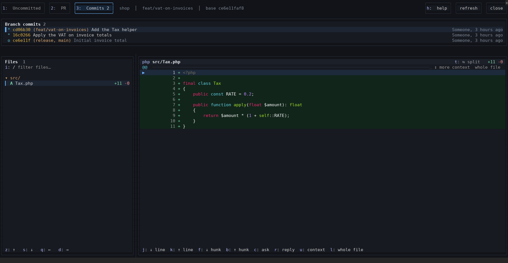
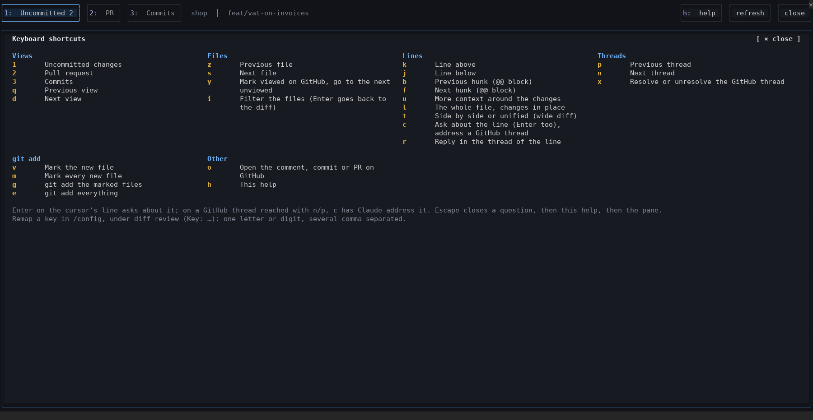
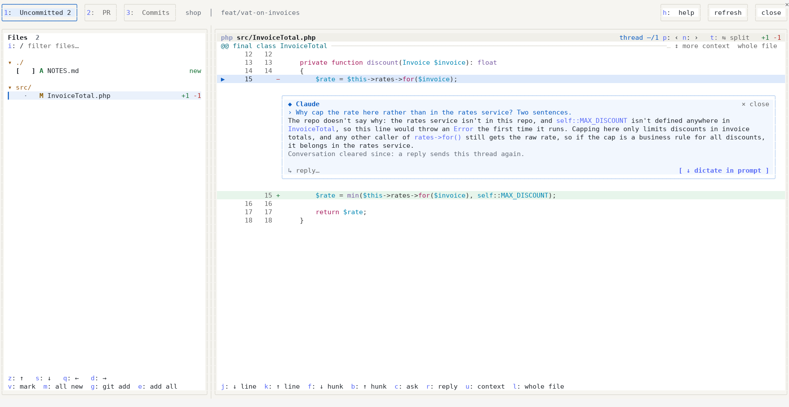

# diff-review

A review pane for [Claude Code](https://code.claude.com): browse your uncommitted changes, the whole pull request or
one commit at a time, and ask Claude about any line without leaving the terminal. The answer is drawn under the line it
is about.



## What it does

- **Three views**: uncommitted changes (new files included), the pull request of the branch, and the branch commits
  with their graph. A file list grouped by directory, each directory folding away, a filter, lockfiles and generated
  files folded away.
- **A narrow pane**: under 120 columns the code takes the whole pane, a bar above it naming the file; `☰ Files` (or
  `i`, which starts typing in the filter) opens the file list over the code, and it closes again as soon as a file is
  picked, or with Escape. A wider pane can collapse its file list the same way (`9`), and pin it back.
- **A readable diff**: syntax highlighting, more context around each change or the whole file, side by side when the
  pane is wide enough, long lines wrapped.
- **Questions on any line**: press `c` (or Enter) on a line, or click its number, and type a question. It goes to the
  conversation with the code around the line; Claude's answer streams into a thread under that line, its mark blinking
  until the answer is in. Threads take replies, survive `/clear` and are kept per branch across sessions. Prefer
  dictating? Send the question from the prompt instead.
- **GitHub review threads**: the inline comments of the pull request appear under their lines, outdated ones on top of
  their file, resolved ones folded. Resolve or unresolve a thread with `x`, open it on GitHub with `o`, or press `c` to
  have Claude change the code to settle it.
- **Review bookkeeping**: the "viewed" boxes of GitHub, `y` to mark a file viewed and jump to the next one, `git add`
  of new files from the list.
- **Keyboard first**: every action has a key, every key can be remapped, `h` lists them all.
- **Dark and light**: follows the Claude Code theme.
- **The view at a glance**: the header sums it up in tiles (files, lines, a viewed bar and the open threads of the
  pull request), the last ones giving way on a narrow pane. On the Desktop they are drawn, and the commits view draws
  the branch lanes instead of git's characters.





## Requirements

- Claude Code with mods support (tested with 2.1.288), in the terminal or Desktop.
- `git`.
- For the pull request features: the [GitHub CLI](https://cli.github.com) `gh`, logged in (`gh auth login`).
- To open pages on GitHub: `xdg-open` (Linux) or `open` (macOS).

## Install

```
/plugin marketplace add nicolas-codemate/claude-code-mods
/plugin install diff-review@codemate-mods
```

Then run `/diff-review`. The pane takes two thirds of the terminal and the keyboard. `ctrl+x` then Tab moves the
keyboard between the prompt and the pane; Escape closes an open question, then the help, then the pane.

## Keys

| Key | Action |
| --- | --- |
| `1` `2` `3` | Uncommitted changes, pull request, commits |
| `q` / `d` | Previous / next view (`a` / `d` on a QWERTY keyboard) |
| `z` / `s` | Previous / next file (`w` / `s` on a QWERTY keyboard) |
| `i` | Filter the files; Enter goes back to the diff (on a narrow pane, opens the file list) |
| `0` | Fold or unfold the directory of the file (or click its arrow) |
| `9` | Collapse the file list behind a bar, or pin it back beside the code |
| `j` / `k` | Line below / above |
| `f` / `b` | Next / previous hunk |
| `u` / `l` | More context / the whole file |
| `t` | Side by side or unified |
| `c` or Enter | Ask Claude about the line; on a GitHub thread, have Claude address it |
| `r` | Reply in the thread of the line |
| `n` / `p` | Next / previous thread, Claude's and GitHub's alike |
| `x` | Resolve or unresolve the GitHub thread |
| `o` | Open the comment, the commit or the pull request on GitHub |
| `y` | Mark the file viewed on GitHub and go to the next one to view |
| `v` / `m` | Mark the new file / every new file for `git add` |
| `g` / `e` | `git add` the marked files / everything |
| `h` | Help |

The navigation keys follow the keyboard layout when the desktop settings tell it (AZERTY or QWERTY); otherwise both
sets work.



## Settings

In `/config`, under diff-review:

- **Theme**: `auto` (the Claude Code theme), `dark` or `light`. Labels, code and Markdown keep the colors of the
  terminal, so a theme opposite to Claude Code's leaves the backgrounds to the terminal.
  
- **Key: …**: one field per action. One letter or digit, several comma separated; empty keeps the default. The help
  (`h`) reports a key it could not take or two actions sharing one.

## What it sends to Claude

A question sends the line, the diff around it and the view it was asked from; a GitHub thread sends its comments. The
context goes in as a part of the conversation the transcript does not show, the question as your message. Nothing is
posted to GitHub, except the viewed boxes and the resolved state you change yourself.

## Development

```
claude plugin validate .
claude plugin test .
```

The hooks module is `hooks/register.tsx`; pure logic sits beside it, the drawing under `hooks/view/`.

## License

MIT
