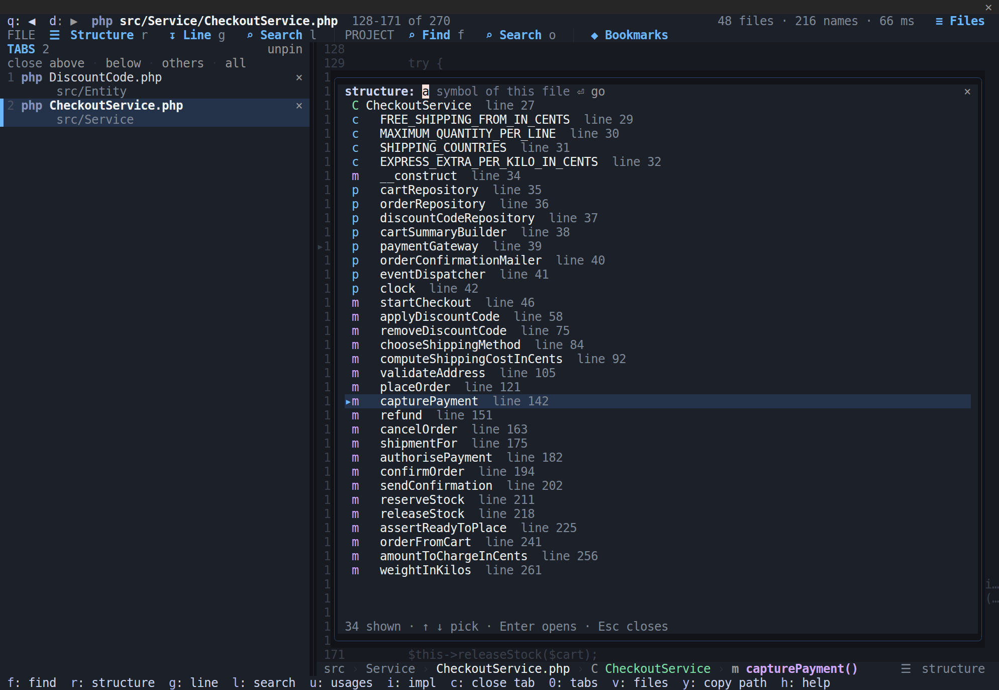
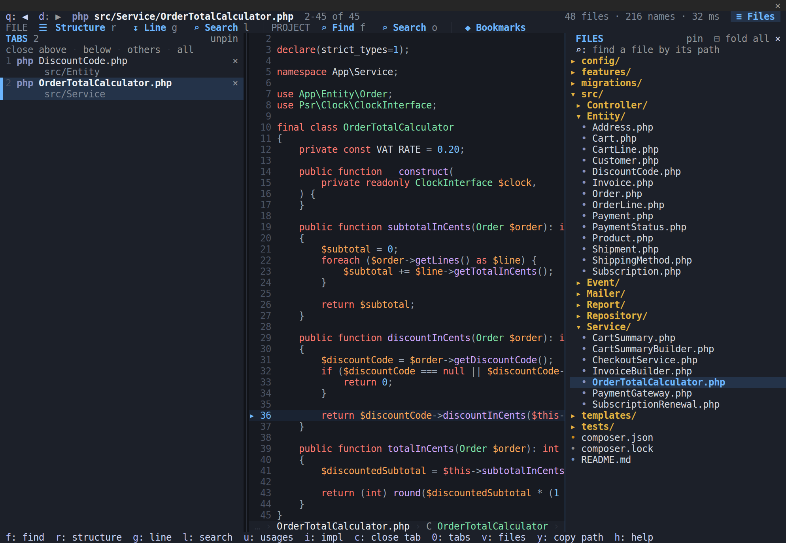
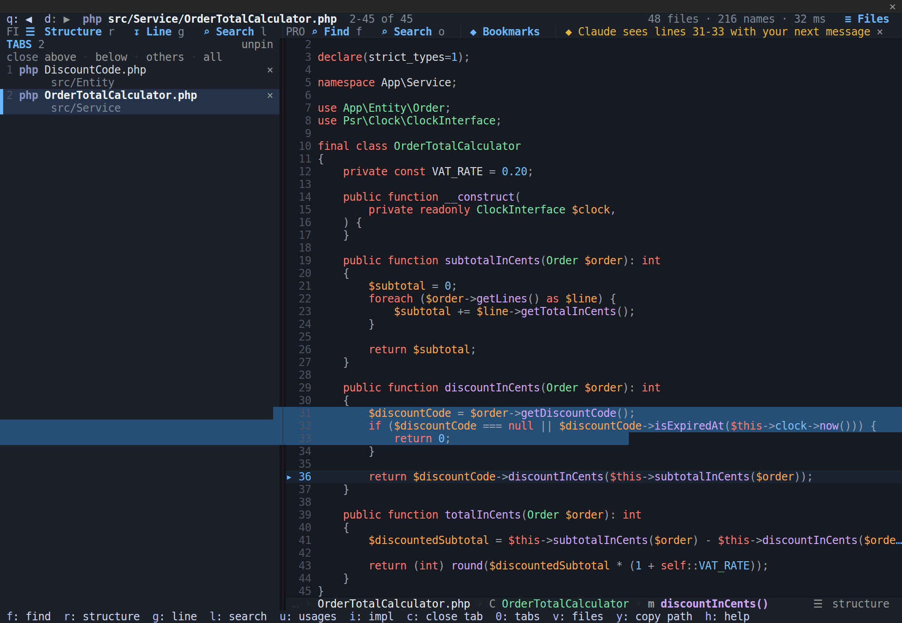

# code-nav

A read-only code pane inside [Claude Code](https://code.claude.com). Claude opens it on the code it talks about, then
you navigate as in an IDE: go to a declaration, list usages, search, browse the files. Nothing is indexed ahead, so
it is ready at once, on a project of ten thousand files too.


**A personal tool**, mostly tested on my own machine, under Linux. Bugs are likely elsewhere: an
[issue](https://github.com/nicolas-codemate/claude-code-mods/issues) is welcome, a pull request even more (see
[how to contribute](../../CONTRIBUTING.md)).

## Install

```
/plugin marketplace add nicolas-codemate/claude-code-mods
/plugin install code-nav@codemate-mods
```

Then ask Claude to show you some code, or run `/code-nav` (optionally with a file, `src/Order.php:42`, or a name,
`OrderRepository::save`). It needs [ripgrep](https://github.com/BurntSushi/ripgrep) (`rg`). To get updates, turn on
auto-update under **Marketplaces** in `/plugin`.

## Claude shows you code

Ask "show me where the total is computed": the pane opens beside the conversation, on the line Claude talks about.


## Navigate

Hover a name: a tag offers `↪ go to definition`, or on a declaration `↪ list usages` and `↑ parents`. Usages are
listed under the code, each previewed in place (`s` / `z` or a click) and opened with `↗ open`. PHP and
TypeScript/Vue names are resolved by type, dependencies included; another language falls back to the name.


## Find and search

The bar under the header: `FILE ☰ Structure · ↧ Line · ⌕ Search`, `PROJECT ⌕ Find · ⌕ Search`, `◆ Bookmarks`.

- **Find**: a file, a class or a method by a few letters (`OrRe` finds `OrderRepository`).
- **Structure**: the declarations of the file, filtered as you type; about twenty languages and formats.
- **Search**: a text in the file or the project, walked match by match (`7 / 50`).




## Tabs and files

Every file opens in a tab, kept for the next session; `close above · below · others · all` cleans up. `≡ Files`
opens the whole project, `vendor/` included. The bar under the code goes from the file's folders to the declaration
you read; each step is clickable.



## Show Claude some lines

Select lines with the mouse: they go to Claude with your next message, as the bar and the prompt say.



## Keys

Everything works with the mouse; keys work while the pane holds the keyboard (`h` lists them all).

| Key | Action | Key | Action |
|---|---|---|---|
| `f` | find a file, class, method | `u` / `i` | usages / implementations |
| `r` | structure of the file | `s` / `z` | walk the list under the code |
| `g` | go to a line | `q` / `d` | back / forward |
| `l` / `o` | search in the file / project | `n` / `p`, `1`–`9` | next / previous tab, tab by number |
| `v` | files | `c` | close the tab |

On a QWERTY keyboard, `a` goes back and `w` walks up.

## Limits

- PHP types are inferred from what the code declares; a value from a service container or `__call` is listed as
  candidates (`○`) rather than resolved. TypeScript is followed through imports and declared types, not inferred.
- Usages of a very common name are analysed up to a thousand matches.
- A Ctrl+click is a plain click: the terminal does not tell them apart, hence the tag over names.
- The wheel scrolls vertically only; a long line scrolls sideways from its `…`.

## Requirements

- Claude Code with mods support (tested with 2.1.328), in the terminal.
- `rg` (ripgrep).

The pane never edits a file. Lines you select go to Claude with your next message, as any message does; nothing else
leaves your machine.

## Development

```
claude plugin validate .
claude plugin test .
```

The pictures come from a fictional demo shop.

## License

MIT
