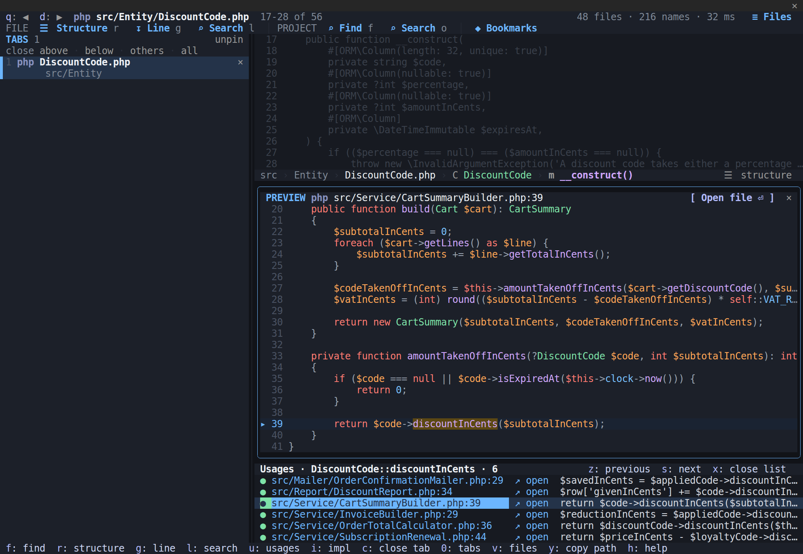
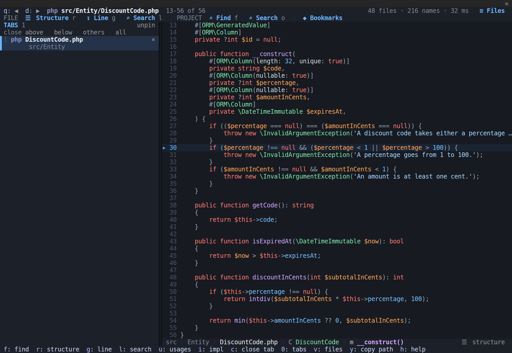
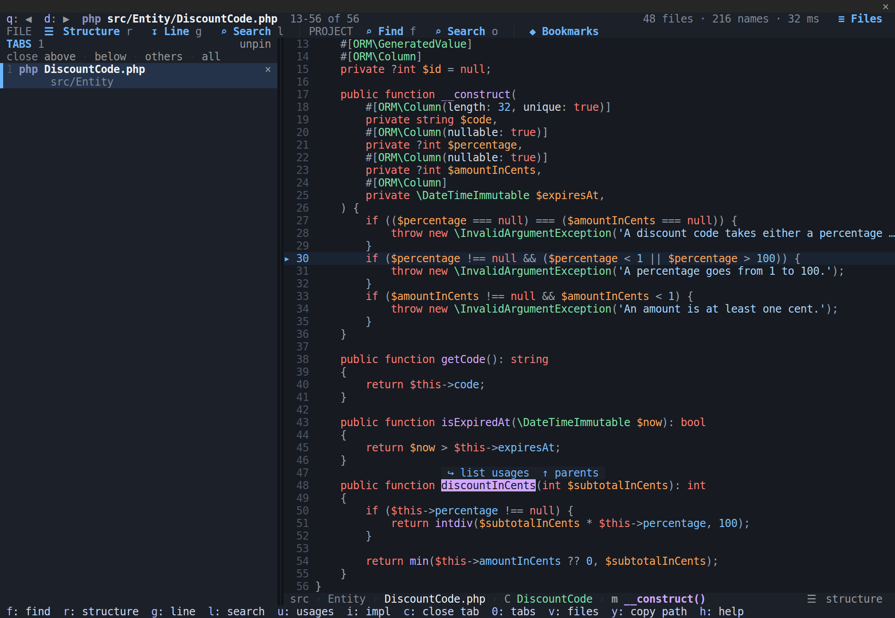
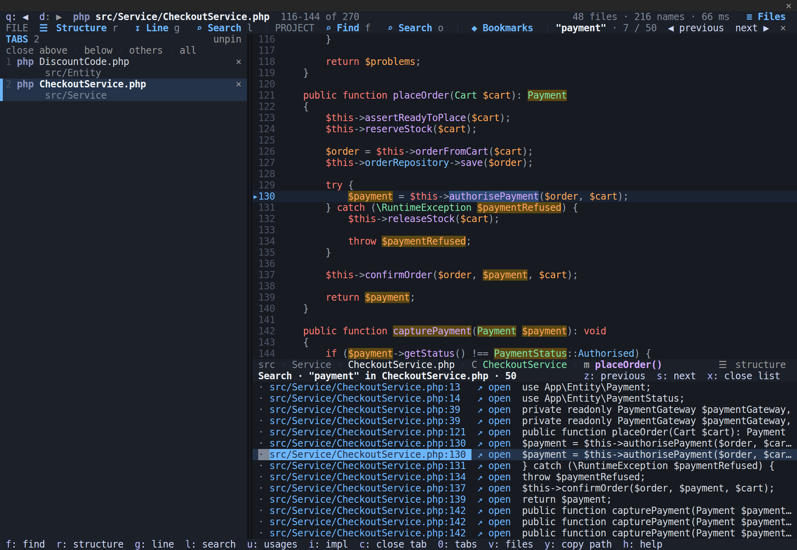
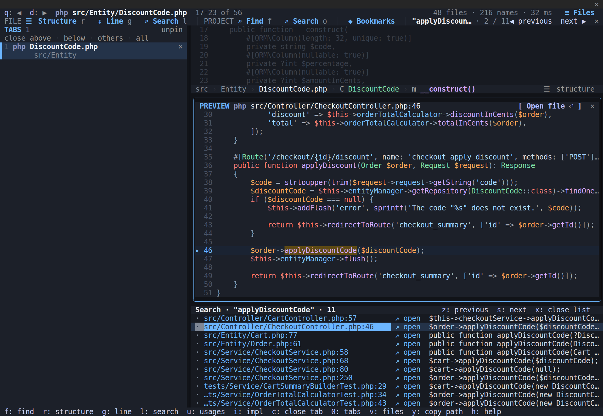

# code-nav

A read-only code navigation pane inside [Claude Code](https://code.claude.com): Claude opens it on the code it talks
about, then you take over. Find a file, a class or a method by a few letters, hover a name to go to its declaration
or list its usages, preview each usage without leaving the file you read. Nothing is indexed ahead, so it is ready
the moment it opens, on a project of ten thousand files too.



It is there for the moment Claude says "the discount is capped in the constructor" and you want to see it with your
own eyes, without starting an IDE. An IDE or a language server answers the same questions from an index of the whole
project and its dependencies, built ahead and kept in memory; code-nav reads only the files a question goes through,
dependencies included, and answers in a fraction of a second.

**A personal tool.** code-nav was built for my own reading and is mostly tested on my own machine, under Linux.
Another system, terminal or language may well bring out bugs I have never met. If you hit one, an
[issue](https://github.com/nicolas-codemate/claude-code-mods/issues) is welcome, a pull request even more: see
[how to contribute](../../CONTRIBUTING.md).

## Install

```
/plugin marketplace add nicolas-codemate/claude-code-mods
/plugin install code-nav@codemate-mods
```

Then ask Claude to show you some code, or run `/code-nav`, alone or followed by a file (`/code-nav src/Order.php:42`)
or a name (`/code-nav OrderRepository::save`). It needs [ripgrep](https://github.com/BurntSushi/ripgrep) (`rg`) on the
`PATH`.

**Updates.** Claude Code does not update a marketplace on its own until you ask it to: turn on auto-update under
**Marketplaces** in `/plugin`, or run `/plugin marketplace update codemate-mods` now and then. Each release is listed
on the [releases page](https://github.com/nicolas-codemate/claude-code-mods/releases).

**Screen width.** The pane sits beside the conversation. From a Full HD screen (1920 pixels) it is comfortable with the
tabs in their column and the files folded behind their `≡ Files` button, as in the pictures below.

## Claude shows you code

Ask in your own words: "show me where the total is computed", "open OrderRepository::save", "how did you keep the
discount under 100%?". Claude calls the mod's `show` tool with a path and a line, or with a class or method name, and
the pane opens on it beside the conversation, the line lit, the keyboard left in the prompt. The files Claude read or
wrote in the session are offered with your recent files when the search opens.



## Hover a name

Every name in the code is a button. As the pointer rests on one, a small tag right above it says where a click goes:
`↪ go to definition` on a call, a property, a class, a function or a variable; `↪ list usages` and `↑ parents` on a
declaration. A click on the tag goes there; a click on the name itself only points at it, so that text can still be
selected with the mouse, and `u` (usages) and `i` (implementations) then ask about it.



- **Definition.** A call, a class, a property: its declaration opens in a tab, a dependency's included.
- **Usages.** The places a method, a class or a property is used, listed under the code.
- **Implementations** (`i`). The classes implementing an interface or extending a class, or their versions of a method.
- **Parents.** Up the hierarchy: the classes and interfaces a class extends or implements, or the methods a method
  overrides or implements, nearest first. The only one there is opens at once.

When there is nowhere to go (no declaration, no usage, a function of PHP itself), a small frame says so right above
the name. The key left of the home row (`q` on an AZERTY keyboard, `a` on a QWERTY one) goes back to where you were,
`d` forward again.

## Usages, previewed

A click on a row of the list, or `s` and `z` (`w` on QWERTY) walking it, previews its place in a frame between the
code and the list, the occurrence lit, while the file you read stays where it is, dimmed behind it. The wheel over the
preview scrolls it through its file. `↗ open`, right of each place, goes into the file in a tab, as do `Open file ⏎`
on the preview, a second click on the row or Enter; `x` closes the list. The usages are the ones the analysis proved
(`●`): another method of the same name, on another class, is left out.

## Find, structure, search

The bar under the header holds them by what they act on: `FILE ☰ Structure · ↧ Line · ⌕ Search`, then
`PROJECT ⌕ Find · ⌕ Search`, then `◆ Bookmarks`. Each frame closes from its `×`, with Escape, or on a click on any
other button of the pane.

- **Find** (`f`). Files, classes, interfaces, functions and methods of the project, ranked as you type: `OrRe` or
  `ordrepo` finds `OrderRepository`, `Order::save` the method, `src/Order` a path, `Order:42` a line of a file. With
  nothing typed, the files you last opened and the ones Claude touched.
- **Line** (`g`). A line number of the file shown, the frame saying how many lines it has.
- **Structure** (`r`). The declarations of the file shown, in a frame in the middle of the code, each indented under
  the one holding it, the one you are reading already picked; a few letters filter them. PHP, TypeScript, JavaScript
  and Vue are read by the mod's own analysis; Python, Go, Rust, Java, Kotlin, C#, Scala, Swift, Dart, C and C++, Ruby,
  Elixir, Lua, Perl and shell scripts by the shape of their declarations; Markdown and AsciiDoc by their headings, YAML,
  JSON, TOML, INI and `.env` files by their keys, CSS by its rules, Makefiles by their targets, Dockerfiles by their
  stages, SQL by its tables and functions, Twig and Jinja by their blocks.

  

- **Search** (`l` in the file, `o` in the project). In the file the matches are lit as you type; in the project Enter
  lists every line holding the text. Lower case matches any case, a capital letter that case only. The bar then says
  where you stand among the matches (`7 / 50`), with `◀ previous`, `next ▶` and `×`: in the file the code itself goes
  from match to match, a match in another file is previewed.

  

  

## Tabs and files

**Tabs.** Every file opened, from the search, a name, a list, the files or Claude, gets a tab, or goes back to its
own; each tab keeps where it was scrolled, and they come back the next time the pane opens on the project. They take a
column left of the code (`unpin`, or `0`, folds them behind `≡ Tabs`). `n` and `p` go to the next and previous tab,
`1` to `9` to that number, `c` closes the one shown; `close above · below · others · all`, under their title, closes
the others.

**Files.** Every directory of the project, `vendor/` and `node_modules/` included, drawn dim and read only when opened,
behind the `≡ Files` button (`v`); `pin` keeps them in a column of their own. The field above the tree finds a file by
a few letters of its path. Opening a file, a click in the code or Escape folds them back.


## Show Claude some lines

Select lines of the code with the mouse, as you would to copy them. The bar says `◆ Claude sees lines 31-33 with your
next message`, the prompt ends with a dim `◆ OrderTotalCalculator.php:31-33 → Claude` as you type, and the message
you send carries those lines, with their file and numbers. Ask "why is the discount zero here?" and Claude knows which
lines "here" is. `×` beside the notice keeps a selection out of your messages.


## Reading a file

- **Where you are.** A bar under the code goes from the directories of the file to the declarations holding the line
  read, each in the color of its kind: `src › Service › OrderTotalCalculator.php › C OrderTotalCalculator ›
  m discountInCents()`. A click on a directory or on the file opens the files on it, a click on a declaration goes to
  it, `☰ structure` opens the structure.
- **Long lines.** A line wider than the pane ends with `…`: a click on it scrolls the code to the right, `‹` back.
- **Bookmarks.** A click on a line number sets a `◆`, a second one takes it off. `◆ Bookmarks` lists them across files,
  `× remove` on a row takes one off; they are kept for the project.

## How names are resolved, with no index

code-nav reads only the files a question goes through:

- **PHP.** A class name is resolved through the file's `namespace` and `use` statements, aliases included, then
  located by Composer's own autoload tables, which cover the project and every dependency: `vendor/` is never scanned,
  yet a click on a Doctrine or Symfony method opens it, marked as a dependency. A member is resolved by inferring the
  type of what it is called on, hop by hop: `$this`, typed and promoted properties, typed parameters, local variables
  from their assignments, return types, `foreach` over typed collections, docblocks and their generics
  (`@extends ServiceEntityRepository<Order>`, `@return Collection<int, Order>`).
- **TypeScript, JavaScript, Vue.** A name is followed through the file's imports, renamed and default imports,
  re-exports and path aliases of `tsconfig.json` included, to the file that declares it. In a Vue component, a name or
  a component tag in the template resolves against the script block.
- **Any other language.** A name is looked up as a word among the declarations of the project and of the file.

When the type cannot be inferred, the pane says so instead of guessing: it lists every declaration of that name, the
most plausible first, marked `○` (not verified) where an inferred answer is marked `●`; usages are marked the same way.
The project's file and declaration lists come from two or three `rg` runs of a few tens of milliseconds, made again
when the search opens, so there is nothing to keep up to date.

## Limits

- The wheel scrolls up and down only: a long line is scrolled sideways from its `…` and `‹` marks.
- PHP types are inferred from what the code declares: an untyped closure parameter, a value coming out of `__call` or
  of a service container, a variable assigned in one branch only are listed as candidates rather than resolved.
  TypeScript is followed through imports and declared types, not inferred: an untyped callback parameter or a `v-for`
  item falls back to candidates. A Vue component named in one lower-case word (`<cart>`) is taken for an HTML element.
- The usages of a PHP constructor are the `new`, `new self`, `new static` and attributes building its class. A magic
  method PHP calls itself (`__toString` on a cast, `__invoke` on a call of the object, `__get`, `__call`…) is listed
  only where its name is written, and the note says so.
- Usages of a very common method name are analysed up to a thousand matches; the title then shows a `+`, and when none
  of those is a usage the note says the search stopped there.
- A file over about 1.5 MB is shown without colors and without clickable names.
- A Ctrl+click is a click: the terminal does not tell the pane which one it was, hence the tag over a name.

## Keyboard too

Everything works with the mouse. Every action also has a key while the pane holds the keyboard (click in it, or use
Claude Code's focus chord); `h` lists them all, and the bar under the code shows the main ones. A key the pane does not
use goes to the prompt, as in any pane. The wheel and Page Up / Page Down scroll the code, `j` and `k` a few lines at a
time; Escape closes a frame, then the pane.

## Settings

In `/config`, under code-nav:

- **Theme**: `auto` follows the theme of Claude Code (`/theme`), `dark` or `light` force one.

## What it sends, and where

Nothing leaves your machine but what goes to Claude in the conversation, as any message does: the lines you selected
in the pane, with their file and numbers, go with your next message as a part of the conversation the transcript does
not show. When Claude shows you code, the tool's answer says which file and line the pane opened on. The pane never
edits a file.

## Requirements

- Claude Code with mods support (tested with 2.1.328), in the terminal. The Desktop app, VS Code and mobile show a
  notice instead of the pane.
- `rg` (ripgrep) for the file list, the declarations and the text search.

## Development

```
claude plugin validate .
claude plugin test .
```

The hooks module is `hooks/register.tsx`; pure logic sits beside it, one folder per analysed language (`hooks/php/`,
`hooks/script/`), the structure of other files under `hooks/outline/`, the coloring under `hooks/syntax/` and the
drawing under `hooks/view/`. The pictures come from a fictional demo shop.

## License

MIT
