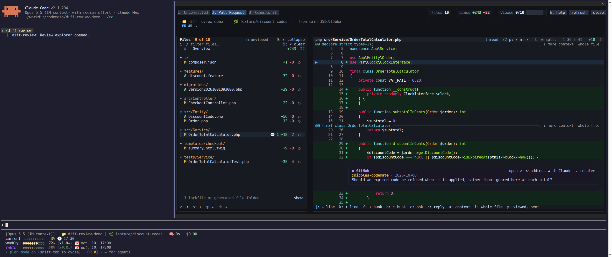
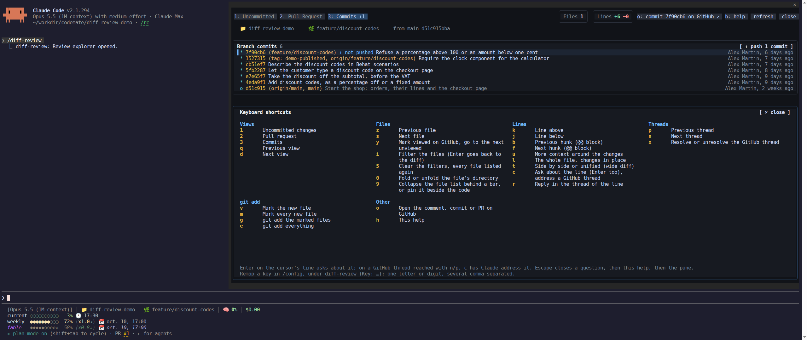

# diff-review

A review pane inside [Claude Code](https://code.claude.com): browse your uncommitted changes, the pull request or one
commit at a time, click any line and ask Claude about it. The answer streams in under that line, and the diff follows
it.


## Install

```
/plugin marketplace add nicolas-codemate/claude-code-mods
/plugin install diff-review@codemate-mods
```

Then run `/diff-review`. It needs `git`, and for the pull request features the [GitHub CLI](https://cli.github.com)
logged in (`gh auth login`).

**Screen width.** The pane sits beside the conversation. From a Full HD screen (1920 pixels) it is comfortable with the
file list collapsed behind a bar (`9`), as in the pictures here; on a wider screen the list stays pinned beside the
code.

## Ask Claude about a line

Click a line number, or press `c` (or Enter) on the cursor's line, and type the question. It goes to the conversation
with the code around the line, and Claude's answer streams into a thread under that line, its mark blinking until the
answer is in. While it grows, the diff scrolls to keep its end in sight, without pushing the line itself off the top;
scrolling or moving yourself stops the follow.

- Reply in the thread with `r`, or dictate in the prompt instead of typing in the pane.
- Threads are kept per branch, across `/clear` and across sessions.
- A thread whose line left the diff, or whose part of the pull request description was rewritten, shows on top of its
  file or of the overview, still readable and closable.
- The file list marks the files holding threads: `◆` for Claude's, `💬` for GitHub review comments.

## Three views

**Uncommitted**: what `git diff` shows, new untracked files included. Mark new files with `v` (or all of them with
`m`) and `git add` them with `g`, or add everything with `e`. The tab dims when there is nothing uncommitted.


**Pull request**: the whole branch against the base the pull request targets, opening on its description.


**Commits**: the branch commits with their graph, one commit's diff at a time. Commits not pushed yet carry
`↑ not pushed`, their count shows on the tab (`Commits ↑2`), and a button pushes them: a second press confirms, a plain
`git push` is used, never from `main` or `master`. When the remote refuses the push (after a rebase, say), the button
offers a force push protected by `--force-with-lease --force-if-includes`, again on a second press.


## GitHub review comments

The inline comments of the pull request appear under their lines, outdated ones on top of their file, resolved ones
folded to one line. Resolve or unresolve a thread with `x`, open it on GitHub with `o`, or press `c` on it to have
Claude change the code to settle it. `n` and `p` walk every thread of the view, Claude's and GitHub's alike.


## Review bookkeeping

- The "viewed" box of GitHub on each file; `y` marks the file viewed and jumps to the next one to view.
- `○ unviewed` hides the files already viewed; a file you just marked stays a moment before it goes.
- A file GitHub does not list yet, because it changed in a commit not pushed, shows `↑` instead of a box.
- The header sums the view up in tiles: files, lines, a viewed bar and the open threads.



## A readable diff

Syntax highlighting (each block of a Vue component in its own language, Behat features as Gherkin), more context around
each change (`u`) or the whole file (`l`), side by side (`t`) when the pane is wide enough, long lines wrapped and
scrolled through line by line. The file list groups files by directory, each folding away (`0`), with a filter (`i`);
lockfiles and generated files stay folded until asked.

## Keyboard first

Every action has a key, every key can be remapped, and `h` lists them all. The navigation keys follow the keyboard
layout when the desktop settings tell it (AZERTY or QWERTY); otherwise both sets work.



| Key | Action |
| --- | --- |
| `1` `2` `3` | Uncommitted changes, pull request, commits |
| `q` / `d` | Previous / next view (`a` / `d` on a QWERTY keyboard) |
| `z` / `s` | Previous / next file (`w` / `s` on a QWERTY keyboard) |
| `i` | Filter the files; Enter goes back to the diff |
| `5` | Clear the filters: the typed filter, the unviewed filter, the folded lockfiles and generated files |
| `0` | Fold or unfold the directory of the file (or click its arrow) |
| `9` | Collapse the file list behind a bar, or pin it back beside the code |
| `j` / `k` | Line below / above |
| `f` / `b` | Next / previous hunk |
| `u` / `l` | More context / the whole file |
| `t` | Side by side or unified |
| `c` or Enter | Ask Claude about the line; on a GitHub thread, have Claude address it |
| `r` | Reply in the thread of the line |
| `n` / `p` | Next / previous thread |
| `x` | Resolve or unresolve the GitHub thread |
| `o` | Open the comment, the commit or the pull request on GitHub |
| `y` | Mark the file viewed on GitHub and go to the next one to view |
| `v` / `m` | Mark the new file / every new file for `git add` |
| `g` / `e` | `git add` the marked files / everything |
| `h` | Help |

`ctrl+x` then Tab moves the keyboard between the prompt and the pane; Escape closes an open question, then the help,
then the pane.

## Settings

In `/config`, under diff-review:

- **Theme**: `auto` (the Claude Code theme), `dark` or `light`.
- **Key: …**: one field per action. One letter or digit, several comma separated; empty keeps the default. The help
  reports a key it could not take, or two actions sharing one.

## What it sends, and where

A question sends the line, the diff around it and the view it was asked from; a GitHub thread sends its comments. The
context goes in as a part of the conversation the transcript does not show, the question as your message. On GitHub,
nothing is posted but what you change yourself: the viewed boxes, the resolved state of a thread, and a push from the
commits view. A failure shows in a red frame on top of the pane until you dismiss it; nothing else interrupts you.

## Requirements

- Claude Code with mods support (tested with 2.1.294), in the terminal. The Desktop app draws the pane too, not
  checked yet.
- `git`; the GitHub CLI `gh` for the pull request features; `xdg-open` (Linux) or `open` (macOS) to open GitHub pages.

## Development

```
claude plugin validate .
claude plugin test .
```

The hooks module is `hooks/register.tsx`; pure logic sits beside it, the drawing under `hooks/view/`. The pictures come
from a fictional shop the `demo/` folder of the repository builds and records.

## License

MIT
