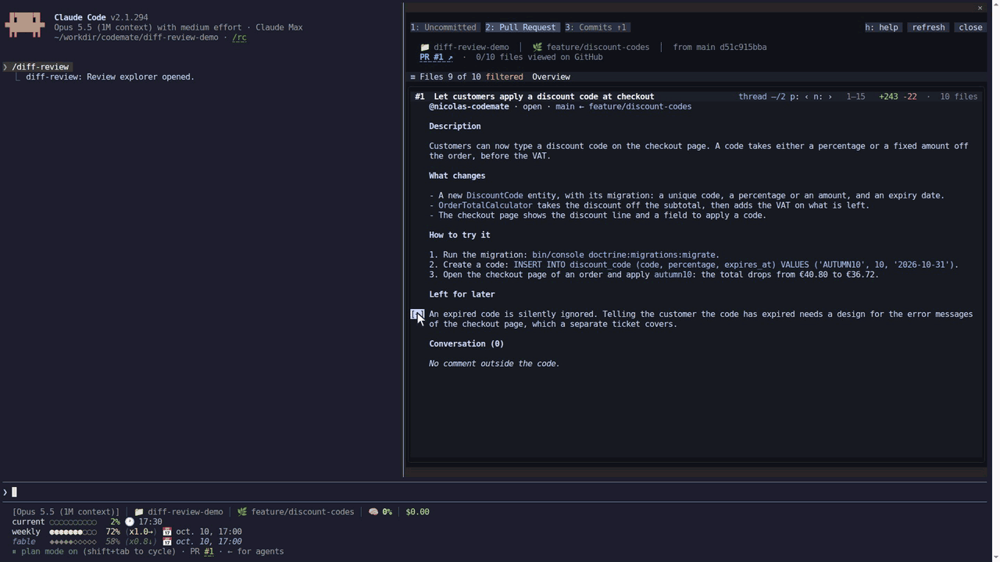
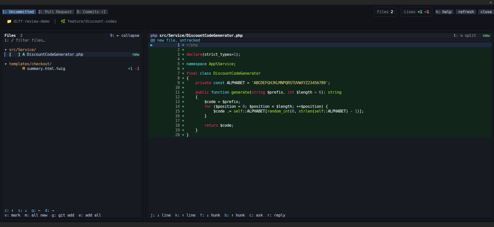
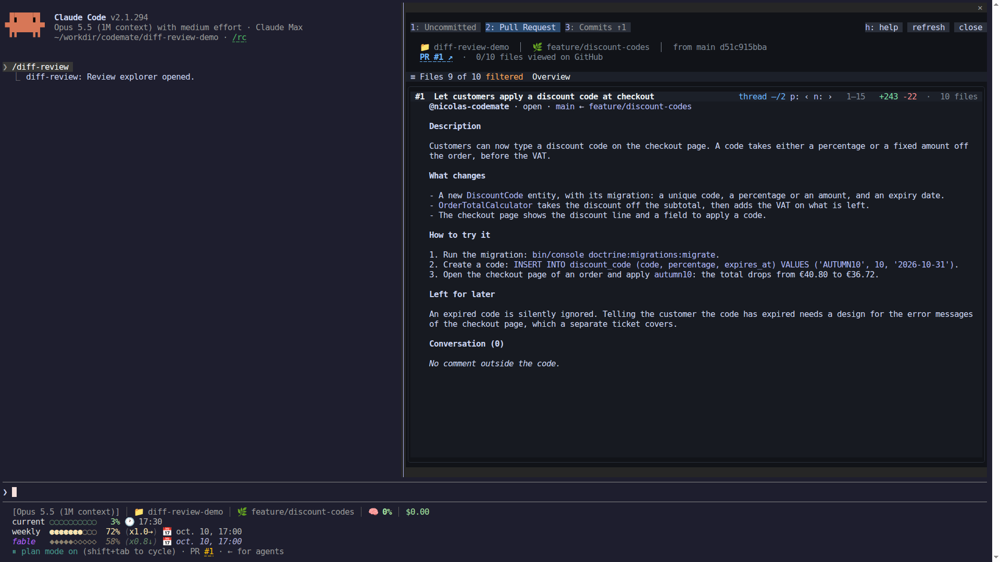
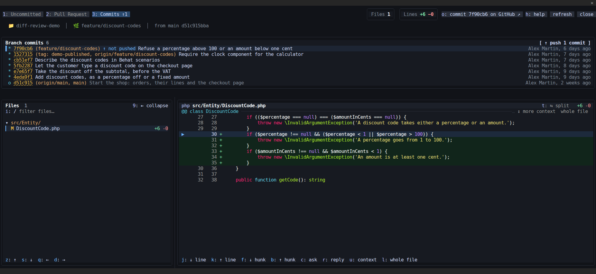
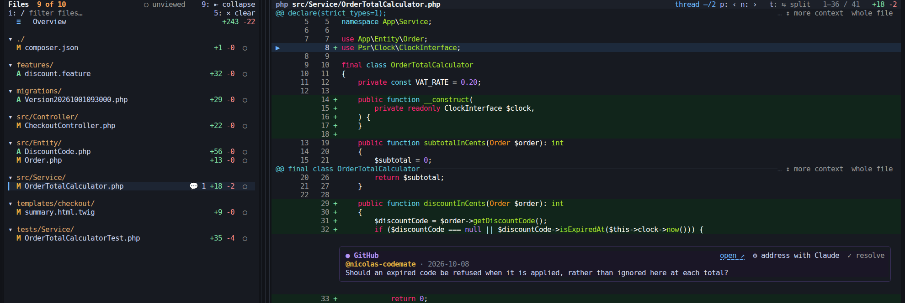
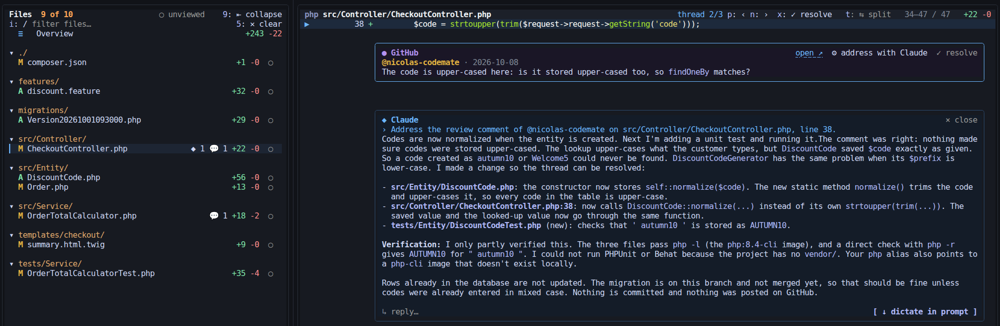
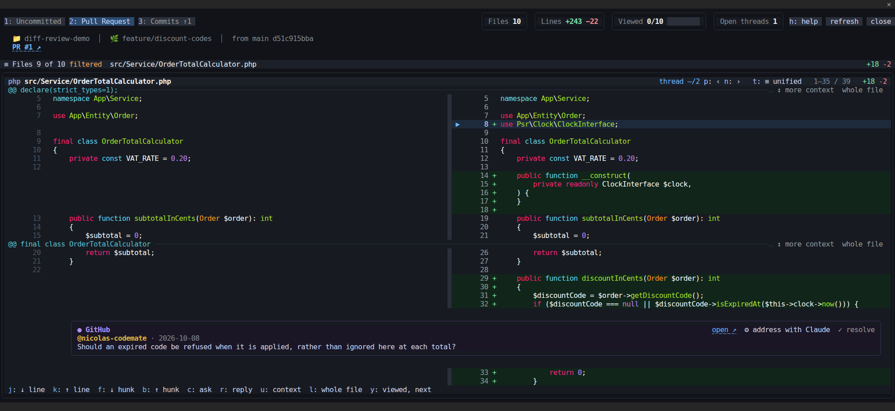
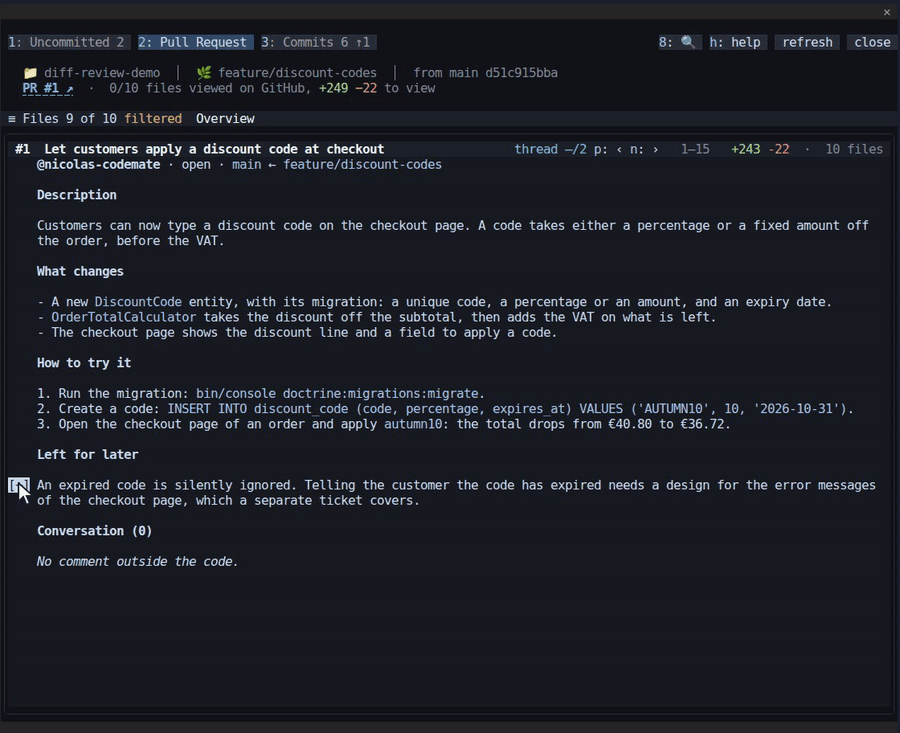
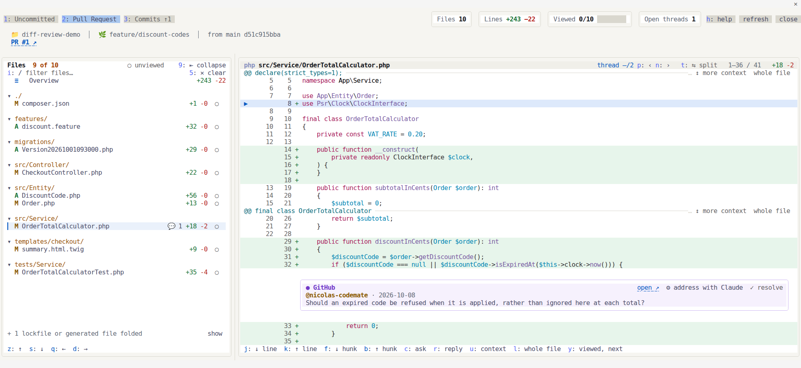

# diff-review

A review pane inside [Claude Code](https://code.claude.com): browse your uncommitted changes, the pull request or one
commit at a time, click any line and ask Claude about it. The answer streams in under that line, and the diff follows
it.



Claude Code's built-in `/diff` shows the session's uncommitted changes and lets you ask about a file's hunks.
diff-review goes on from there to a whole review: the pull request and each commit besides uncommitted changes,
questions answered under the very line they are about, the GitHub review comments and their resolving, the viewed
boxes, and pushing.

**A personal tool.** diff-review was built for my own reviews and is mostly tested on my own machine, under Linux.
Another system, terminal or way of working may well bring out bugs I have never met. If you hit one, an
[issue](https://github.com/nicolas-codemate/claude-code-mods/issues) is welcome, a pull request even more: see
[how to contribute](../../CONTRIBUTING.md).

## Install

```
/plugin marketplace add nicolas-codemate/claude-code-mods
/plugin install diff-review@codemate-mods
```

Then run `/diff-review`. It needs `git`, and for the pull request features the [GitHub CLI](https://cli.github.com)
logged in (`gh auth login`).

**Updates.** Claude Code does not update a marketplace on its own until you ask it to: turn on auto-update under
**Marketplaces** in `/plugin`, or run `/plugin marketplace update codemate-mods` now and then. Each release is listed
on the [releases page](https://github.com/nicolas-codemate/claude-code-mods/releases).

**Screen width.** The pane sits beside the conversation. From a Full HD screen (1920 pixels) it is comfortable with the
file list collapsed behind its `≡ Files` bar, as in the animation above; on a wider screen the list stays pinned beside
the code, as in the pictures below.

## Ask Claude about a line

Click a line number and type the question. It goes to the conversation
with the code around the line, and Claude's answer streams into a thread under that line, its mark blinking until the
answer is in. While it grows, the diff scrolls to keep its end in sight, without pushing the line itself off the top;
scrolling or moving yourself stops the follow.

- Reply in the thread, or dictate in the prompt instead of typing in the pane.
- Threads are kept per branch, across `/clear` and across sessions.
- A thread whose line left the diff, or whose part of the pull request description was rewritten, shows on top of its
  file or of the overview, still readable and closable.
- The file list marks the files holding threads: `◆` for Claude's, `💬` for GitHub review comments.

## Three views

The pane opens on the uncommitted changes, or on the pull request when everything is committed. The tabs count the
uncommitted files and the branch commits, and count again after each edit or command of Claude.

**Uncommitted**: what `git diff` shows, new untracked files included. Tick new files and `git add` them, or add
everything, from the file list. The tab counts the files (`Uncommitted 3`) and dims when there is nothing uncommitted.

Once files are staged, `✓ commit` hands the commit to Claude, as if you typed it: your commit skill writes the message
when you have one, else Claude follows the style of the recent commits, and only what is staged goes in. When the
commit is made the pane moves to the commits view, ready to push; a skill that asks first leaves the pane waiting for
your reply in the conversation.



**Pull request**: the whole branch against the base the pull request targets, opening on its description.



**Commits**: the branch commits with their graph, one commit's diff at a time. Commits not pushed yet carry
`↑ not pushed`, their count shows on the tab after the branch's (`Commits 5 ↑2`), and a button pushes them: a second press confirms, a plain
`git push` is used, never from `main` or `master`. When the remote refuses the push (after a rebase, say), the button
and the notice that reports it offer a force push protected by `--force-with-lease --force-if-includes`, again on a
second press; the notice goes once the force push starts.



## GitHub review comments

The inline comments of the pull request appear under their lines, outdated ones on top of their file, resolved ones
folded to one line. Resolve or unresolve a thread, open it on GitHub, or have Claude change the code to settle it,
from the buttons of the thread. The header walks every thread of the view, Claude's and GitHub's alike.



**Address with Claude.** One click hands a review comment to Claude, with the code around its line: Claude changes the
code to settle it, or explains why it should not and suggests a reply. The answer lands under the comment as a thread
you can reply to. Nothing is posted on GitHub: resolving the comment and pushing stay yours.



## Review bookkeeping

- The "viewed" box of GitHub on each file, ticked from the file list.
- `○ unviewed` hides the files already viewed; a file you just marked stays a moment before it goes.
- A file GitHub does not list yet, because it changed in a commit not pushed, shows `↑` instead of a box.
- A file changed since you ticked it shows `!` and comes back under `○ unviewed`. Ticked from the pane, it opens on
  the first line changed since.
- The header sums the view up in tiles: files, lines, a viewed bar, the lines still to view and the open threads. The
  lines still to view go down with each file ticked.


## A readable diff

Syntax highlighting (each block of a Vue component in its own language, Behat features as Gherkin), more context around
each change or the whole file, side by side when the pane is wide enough, long lines wrapped and scrolled through line
by line. The file list groups files by directory, each folding away, with a filter; lockfiles and generated files stay
folded until asked.



## Search all changes

Select a variable name or any text with the mouse and press `8`, or the header's 🔍 button: every change of the view is
searched for it. A bar opens under the header, over the file list and the code alike, every occurrence is lit, and each
file shows how many it holds (`🔍 3`). The bar's `↑` and `↓` (or `6` and `7`) walk them back and forth, from file to
file, its field changes the term, and `🧹 clear` ends the search. The counts follow Claude's edits. Where the selection
cannot be read (fullscreen off), the bar opens empty, to type the term in. A line holding the term is
drawn without its syntax colors, so that the term itself can be lit.



## Keyboard too

Everything works with the mouse. Every action also has a key; the help button of the pane lists them all.

## Settings

In `/config`, under diff-review:

- **Theme**: `auto` follows the theme of Claude Code (`/theme`), `dark` or `light` force one. The pane is fully light
  when Claude Code is: forced to the other mode, it leaves its backgrounds to the terminal so that text stays readable.

  

## What it sends, and where

A question sends the line, the diff around it and the view it was asked from; a GitHub thread sends its comments. The
context goes in as a part of the conversation the transcript does not show, the question as your message. On GitHub,
nothing is posted but what you change yourself: the viewed boxes, the resolved state of a thread, and a push from the
commits view. A failure shows in a red frame on top of the pane until you dismiss it; nothing else interrupts you.

## Requirements

- Claude Code with mods support (tested with 2.1.294), in the terminal. The Desktop app, VS Code and mobile show a
  notice instead of the pane.
- `git`; the GitHub CLI `gh` for the pull request features; `xdg-open` (Linux) or `open` (macOS) to open GitHub pages.

## Development

```
claude plugin validate .
claude plugin test .
```

The hooks module is `hooks/register.tsx`; pure logic sits beside it, the drawing under `hooks/view/`. The pictures come
from a fictional demo shop.

## License

MIT
