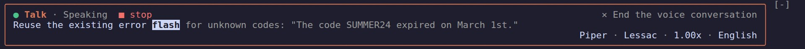
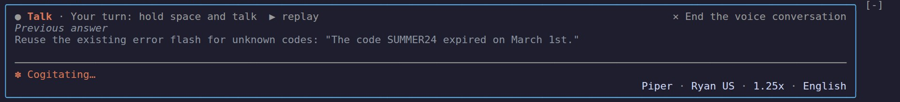

# talk

A voice conversation mode for [Claude Code](https://code.claude.com), for the moments you think a problem through
together rather than hand over work: you dictate, Claude answers as a colleague would out loud, short and in plain
sentences, and its answer is read aloud while a band above the prompt highlights each word as it is spoken.



**A personal tool.** talk was built for my own brainstorming and is mostly tested on my own machine, under Linux.
Another system, terminal or way of working may well bring out bugs I have never met. If you hit one, an
[issue](https://github.com/nicolas-codemate/claude-code-mods/issues) is welcome, a pull request even more: see
[how to contribute](../../CONTRIBUTING.md).

## Install

```
/plugin marketplace add nicolas-codemate/claude-code-mods
/plugin install talk@codemate-mods
```

## Use

| Command | What it does |
| --- | --- |
| `/talk` | Turns the mode on and shows its band above the prompt |
| `/talk off` | Turns it off: answers go back to normal |
| `/talk stop` | Silences the answer being read |
| `/talk replay` | Reads the last answer again |
| `/talk test` | Reads a test sentence, to hear the voice |
| `/talk status` | Lists the voices this machine can use, and why the others cannot |
| `/talk setup` | Installs the local voice, Piper, and a voice of the language |

**Starting and leaving.** While the mode is off, a line above the prompt holds a button that starts a voice
conversation, in the language of the mode; the `Start button above the prompt` option in `/config` hides it. While
it is on, the band's top line ends with the button that leaves it.


**Speaking.** Claude Code has no microphone that stays open: you talk with its own dictation, `/voice`, holding the
space bar while you speak. With `"voice": { "enabled": true, "mode": "tap" }` in your settings, one tap starts it and a
second one sends the message; in hold mode, `"autoSubmit": true` sends it as you release the key. Starting to type or
dictate cuts the voice short, as in a conversation.

**The band.** Above the prompt, the whole answer being read, its word highlighted, with `stop` and `replay`; an answer
too long for the band shows from the sentence being read on. Once you send your next message, it stays there greyed as
the previous answer, replay still at hand. Below it, a line pulses with the word of Claude Code's own spinner while
Claude is thinking, then, once the answer is in, while its voice is made ready. The band's frame tells the state:
Claude's color while the voice reads, blue while Claude works, grey at rest. Its top line ends with the button that
ends the conversation, in the conversation's language.



**Settings.** The line at the bottom right of the band names the engine, its model when it has several (ElevenLabs),
the voice, the speed and the language. Beside the engine, in color, what the Claude Code session has cost so far: the
ElevenLabs credits it used and those left on the account, or for OpenAI an estimate in dollars from the minutes of
voice made.

Each item opens its choices above it:

- a choice is only selected until **Apply** saves it as `/config` does: the mod then reloads, and an answer being read
  goes on from its current sentence;
- **Cancel** leaves the setting as it was, and while one setting is open, the others wait;
- an engine the machine cannot use is dimmed;
- the language chosen is the one Claude answers in, whatever Claude Code's own language setting says.

The voices are those of the engine in use: every Piper voice of the language in medium quality (each speaker of a voice
of a few), the OpenAI voices, the voices of your ElevenLabs account.

- `▶` beside a voice reads the same sentence with it, to compare;
- a Piper voice marked `↓` is downloaded the first time it is heard or applied, its progress on the band's top line;
- **All · Female · Male**, on the list's title line, keeps the voices of one gender where it is known: ElevenLabs tells
  it, the mod labels OpenAI's voices and the usual Piper ones.


**What is read.** While the mode is on, Claude is asked to answer for the ear: a few sentences, one idea at a time, no
tables or lists. Code, commands and paths go in code blocks, which stay on screen and are never read. Only the final
answer of a turn is read; the work in between goes on as usual.

## Voices

The mod picks the best voice the machine has, in this order, unless you choose one in the band or `/config`:

| Voice | Quality | English words in French | Cost | Where the text goes |
| --- | --- | --- | --- | --- |
| **ElevenLabs** | The most natural | Read as a developer says them | A free plan, then a subscription | ElevenLabs |
| **OpenAI** | Natural | Read as a developer says them | A few cents per hour of talk | OpenAI |
| **Piper** | A little robotic | Respelled for the French voice (`GitHub` becomes « guite heube ») | Free | Stays on the machine |
| **System voice** | Robotic (`say` on macOS is better) | Respelled | Free | Stays on the machine |

The words of the band follow the voice exactly with ElevenLabs, which times each character, and with Piper installed
with `onnx` as below, which times each sound it makes. With the other voices their timing is estimated from the length
of each word, close enough to follow along.

**ElevenLabs or OpenAI.** Each needs an API key. Give it when `/plugin install` asks for the mod's options (it is kept
in the system's secure storage; `/config` does not show it), or set `ELEVENLABS_API_KEY` or `OPENAI_API_KEY` in the
environment Claude Code starts in, for example in your shell's startup file (`~/.bashrc`, `~/.zshrc`...):

```
export ELEVENLABS_API_KEY=...
```

Claude Code reads its environment when it starts: open a new terminal and start it again (`claude --resume` takes the
conversation back). With a key set, `Auto` picks that engine. Creating the key, the costs, the voices and, for
ElevenLabs, the pronunciation of a word: [ElevenLabs](docs/elevenlabs.md), [OpenAI](docs/openai.md).

**Piper.** A local voice, free, about 60 MB per voice. With no cloud key set, `/talk` installs it by itself the first
time, under `~/.local/share/piper`: a Python environment of its own with Piper and `onnx`, and a voice of the language,
the band following each step. A change of language downloads that language's voice the same way. It needs `python3`
with its `venv` module and `curl`: when one is missing, the band gives the command that installs it on your system
(Homebrew, apt, dnf, pacman, zypper or apk). `/talk setup` runs the install on demand, and the `Install the local
voice` option in `/config` turns the automatic one off. By hand, it comes to:

```
python3 -m venv ~/.local/share/piper/venv
~/.local/share/piper/venv/bin/pip install piper-tts onnx
mkdir -p ~/.local/share/piper/voices && cd ~/.local/share/piper/voices
curl -LO https://huggingface.co/rhasspy/piper-voices/resolve/main/fr/fr_FR/siwis/medium/fr_FR-siwis-medium.onnx
curl -LO https://huggingface.co/rhasspy/piper-voices/resolve/main/fr/fr_FR/siwis/medium/fr_FR-siwis-medium.onnx.json
```

The mod finds `piper` there or on the `PATH`, and takes the first voice of the language in that folder; the
`Piper command` and `Piper voice` options name others.

**Playing the sound** needs one of `pw-play`, `paplay`, `aplay` or `ffplay` on Linux; macOS has `afplay`.

## Options

In `/config`: the voice engine, the language (French, English, Spanish, German, Italian: the language Claude answers in
and the voice speaks), the speaking speed, whether the local voice installs itself, whether the start button shows
above the prompt, and per engine its key, model and voice.

## Adding a voice service

Each voice service is a provider: one file under `hooks/providers/` implementing one interface, which the rest of the
mod goes through without knowing any service by name. [Adding a voice service](docs/adding-a-voice-service.md) walks
through writing one, its tests, and the checks to run.
