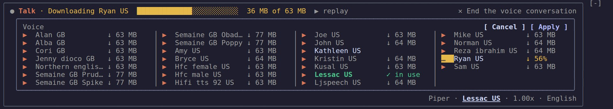

# talk

A voice conversation mode for [Claude Code](https://code.claude.com): you dictate, Claude answers in a few plain
sentences, and its answer is read aloud while a band above the prompt highlights each word.


**A personal tool.** Built for my own use and mostly tested on my machine, under Linux. If you hit a bug, an
[issue](https://github.com/nicolas-codemate/claude-code-mods/issues) is welcome, a pull request even more: see
[how to contribute](../../CONTRIBUTING.md).

## Install

```
/plugin marketplace add nicolas-codemate/claude-code-mods
/plugin install talk@codemate-mods
```

## Use

| Command | What it does |
| --- | --- |
| `/talk` | Turns the mode on and shows its band above the prompt |
| `/talk off` | Turns it off: answers go back to normal |
| `/talk stop` | Silences the answer being read |
| `/talk replay` | Reads the last answer again |
| `/talk test` | Reads a test sentence, to hear the voice |
| `/talk status` | Lists the voices this machine can use, and why the others cannot |
| `/talk setup` | Installs the local voice, Piper, and a voice of the language |

**Starting and leaving.** While the mode is off, a button above the prompt starts a conversation (the `Start button
above the prompt` option hides it). While it is on, a button at the top of the band ends it.


**Speaking.** Use Claude Code's own dictation, `/voice`: hold the space bar while you speak. In your settings,
`"voice": { "enabled": true, "mode": "tap" }` starts it with one tap and sends with a second; in hold mode,
`"autoSubmit": true` sends on release. Typing or dictating cuts the voice short.

**The band.**

- The answer being read, its current word highlighted, with `stop` and `replay`.
- Once you send your next message, it stays greyed as the previous answer, and a line pulses with Claude Code's spinner
  word while Claude thinks.
- Its frame tells the state: Claude's color while the voice reads, blue while Claude works, grey at rest.


**Settings.** The line at the bottom right of the band names the engine, its model (ElevenLabs), the voice, the speed
and the language, with the session's cost in color beside the engine. Each item opens its choices:

- **Apply** saves a choice, as `/config` does; **Cancel** leaves it.
- An engine the machine cannot use is dimmed.
- The language is the one Claude answers in, whatever Claude Code's own language setting says.
- `▶` plays a voice on a sample sentence; a Piper voice marked `↓` downloads the first time it is heard or applied.
- **All · Female · Male** filters the voices by gender.




**What is read.** Claude is asked to answer for the ear: a few sentences, no tables or lists. Code, commands and paths
go in code blocks, shown but never read. Only the final answer of a turn is read.

## Voices

The mod picks the best voice available, in this order, unless you choose one:

| Voice | Quality | English words in French | Cost | Where the text goes |
| --- | --- | --- | --- | --- |
| **ElevenLabs** | The most natural | Read as a developer says them | A free plan, then a subscription | ElevenLabs |
| **OpenAI** | Natural | Read as a developer says them | A few cents per hour of talk | OpenAI |
| **Piper** | A little robotic | Respelled (`GitHub` becomes « guite heube ») | Free | Stays on the machine |
| **System voice** | Robotic (`say` on macOS is better) | Respelled | Free | Stays on the machine |

The highlight follows the voice exactly with ElevenLabs and Piper; with the others it is estimated from word lengths.

**ElevenLabs or OpenAI.** Give the API key when `/plugin install` asks for the mod's options (kept in the system's
secure storage), or set `ELEVENLABS_API_KEY` or `OPENAI_API_KEY` in your shell's startup file (`~/.bashrc`,
`~/.zshrc`...) and restart Claude Code (`claude --resume` takes the conversation back):

```
export ELEVENLABS_API_KEY=...
```

Setup, costs and voices of each: [ElevenLabs](docs/elevenlabs.md), [OpenAI](docs/openai.md).

**Piper.** A free local voice, about 60 MB per voice. With no cloud key, `/talk` installs it the first time under
`~/.local/share/piper`, the band following each step. It needs `python3` with its `venv` module and `curl`; when one is
missing, the band gives the command for your system. `/talk setup` runs the install on demand; the `Install the local
voice` option turns the automatic one off. By hand:

```
python3 -m venv ~/.local/share/piper/venv
~/.local/share/piper/venv/bin/pip install piper-tts onnx
mkdir -p ~/.local/share/piper/voices && cd ~/.local/share/piper/voices
curl -LO https://huggingface.co/rhasspy/piper-voices/resolve/main/fr/fr_FR/siwis/medium/fr_FR-siwis-medium.onnx
curl -LO https://huggingface.co/rhasspy/piper-voices/resolve/main/fr/fr_FR/siwis/medium/fr_FR-siwis-medium.onnx.json
```

The `Piper command` and `Piper voice` options name another install.

**Playing the sound** needs `pw-play`, `paplay`, `aplay` or `ffplay` on Linux; macOS has `afplay`.

## Options

In `/config`: the engine, the language (French, English, Spanish, German, Italian), the speed, the automatic install
of the local voice, the start button, and per engine its key, model and voice.

## Adding a voice service

Each voice service is one file under `hooks/providers/` implementing a common interface:
[adding a voice service](docs/adding-a-voice-service.md) walks through it.
