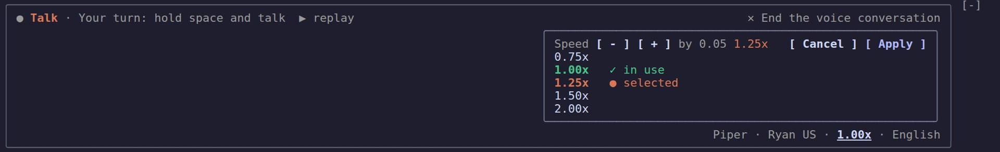

# talk

A voice conversation mode for [Claude Code](https://code.claude.com): you dictate, Claude answers in a few plain
sentences, and its answer is read aloud while a band above the prompt highlights each word.


Built for my own use and mostly tested on Linux: [issues and pull requests](../../CONTRIBUTING.md) are welcome.

## Install

```
/plugin marketplace add nicolas-codemate/claude-code-mods
/plugin install talk@codemate-mods
```

## Use

| Command | What it does |
| --- | --- |
| `/talk` | Turns the mode on |
| `/talk off` | Turns it off |
| `/talk test` | Reads a test sentence |
| `/talk status` | Lists the voices this machine can use, and why the others cannot |
| `/talk setup` | Installs the local voice |

Speak with Claude Code's dictation, `/voice` (hold the space bar); typing or dictating cuts the voice short. Code and
commands stay on screen, never read. The band's bottom line opens the engine, voice, speed and language.



## Voices

The mod picks the best voice available, in this order:

| Voice | Quality | Cost | Where the text goes |
| --- | --- | --- | --- |
| **ElevenLabs** | The most natural | A free plan, then a subscription | ElevenLabs |
| **OpenAI** | Natural | A few cents per hour of talk | OpenAI |
| **Piper** | A little robotic | Free | Stays on the machine |
| **System voice** | Robotic | Free | Stays on the machine |

**ElevenLabs and OpenAI** need an API key: give it when `/plugin install` asks, or set `ELEVENLABS_API_KEY` or
`OPENAI_API_KEY` in the environment Claude Code starts in. See [ElevenLabs](docs/elevenlabs.md) and
[OpenAI](docs/openai.md).

**Piper** installs itself the first time, under `~/.local/share/piper`. It needs `python3`, its `venv` module and
`curl`: when one is missing, the band gives the command for your system.

The sound plays through `pw-play`, `paplay`, `aplay` or `ffplay` on Linux, `afplay` on macOS.

## Adding a voice service

See [adding a voice service](docs/adding-a-voice-service.md).
